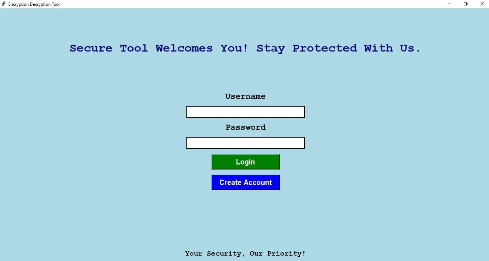
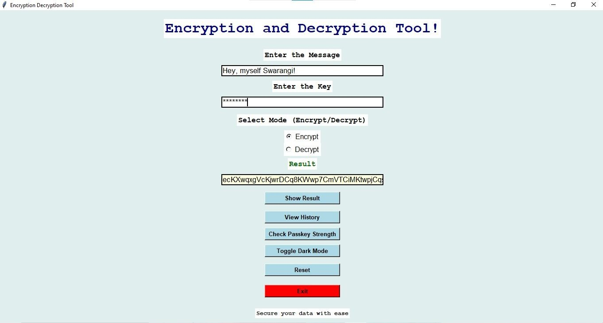

# 🔐 Secure Tool — Encryption & Decryption Desktop App

**A Python + Tkinter desktop app with user accounts that encodes and decodes messages with a user-chosen key, checks key strength and keeps a history of actions.**


| Login | Encrypt / decrypt |
|:---:|:---:|
|  |  |

> One of my early Python projects, built to learn GUI programming, file handling and basic cipher logic. It is **not** meant for protecting real data — see [Security notes](#-security-notes).

---

## 🎯 Objectives

- Build a complete multi-screen desktop GUI in Tkinter.
- Implement a reversible key-based cipher and its inverse.
- Add simple account management and persistent history using local files.

## ✨ Features

| Feature | Description |
|---|---|
| Accounts | Create an account and log in (minimum 8-character password) |
| Encode / decode | Enter a message and a key, choose Encrypt or Decrypt, and see the result |
| Key strength | Checks a key for length and a mix of character types |
| Save / load | Save an encoded message to a file of your choice and load it back |
| History | Shows the contents of `message_history.txt` (the app does not write to this file yet) |
| Dark mode | Toggle between light and dark themes |

## ⚙️ How the cipher works

Each character of the message is shifted by the code of the matching key character (repeating the key), modulo 256 — a Vigenère-style cipher — and the result is Base64-encoded so it can be copied as text. Decoding reverses both steps.

```python
enc = chr((ord(msg[i]) + ord(key[i % len(key)])) % 256)   # then base64.urlsafe_b64encode
```

## 🚀 Run

```bash
git clone https://github.com/SwarangiK-21/Encryption-Decryption-Project.git
cd Encryption-Decryption-Project
python secure_tool.py
```

Only the Python standard library is used (Tkinter is included with most Python installers). The app creates `accounts.json` in the working folder; it and `message_history.txt` are git-ignored.

## 📂 Structure

```
Encryption-Decryption-Project/
├── secure_tool.py   # The whole app: login, cipher, history, key strength, theme
└── assets/          # Screenshots
```

## 🔒 Security notes

- The cipher is a **classical Vigenère-style shift**, which is easy to break with frequency analysis. It is not real encryption.
- Passwords are stored **in plain text** in `accounts.json`.
- For real use, passwords should be hashed with a slow, salted algorithm (e.g. `bcrypt` or `hashlib.scrypt`), and messages encrypted with an authenticated cipher such as `cryptography.fernet`.

## 🔭 Future enhancements

- Replace the cipher with Fernet (AES + HMAC) and hash passwords with scrypt.
- Split the single script into UI, crypto and storage modules, and add tests.
